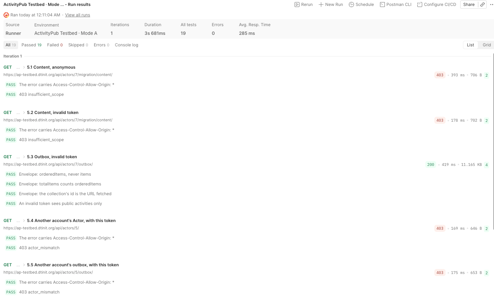
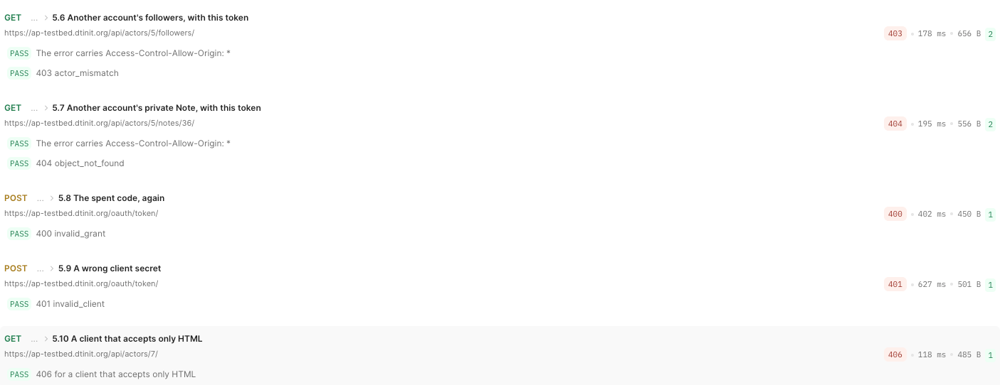

# What Each Collection Holds (Mode A)

Every account on the testbed is provisioned with the same content at signup, so a destination always has
something to migrate, and every tester sees the same numbers. This page shows what each collection holds,
with real items served by production, and, just as important, **what each one never shows**: the rules that
keep a migration token to one account and keep private content private.

The examples come from `https://ap-testbed.dtinit.org/api/actors/5/`, fetched on 2026-10-20 with that
account's own portability token. For how the pieces fit together, see the [overview](overview.md).

## The account at a glance

| Collection | Route | With the account's token | Anonymous | What it holds |
|---|---|---|---|---|
| Outbox | `outbox` | 43 | 19 | Every activity: a `Create` per Note, the Likes, the Follows, and the `Create` that announces the Actor |
| Migration outbox | `migration/outbox` | 30 | 10 | Only the `Create` of each Note |
| Content | `migration/content` | 30 | `403` | The Notes themselves, without activity wrappers |
| Liked | `liked` | 6 | `403` | The objects of the account's Likes |
| Following | `migration/following` | 6 | 6 | The accounts it follows |
| Blocked | `migration/blocked` | 2 | `403` | The accounts it blocks ([FEP-c648](https://codeberg.org/fediverse/fep/src/branch/main/fep/c648/fep-c648.md)) |
| Followers | `followers` | 8 | `403` | Its followers: readable, but not copied (LOLA §6.6) |

The 30 Notes are dated every 4 days, from the day of the signup back about four months (116 days). They
cycle through three visibilities, 10 each: **public**, **followers-only** and **private**. The 6 Likes cycle
the same way, 2 each. Every remote account lives on a reserved `.example` domain, so a destination that acts
on one (for example, re-following it) reaches no real server.

`visibility` is the testbed's own field, not part of Activity Streams: it says which audience an item has.
Real servers express the same thing with `to` and `cc` addressing.

## The rules that keep it private

These are the guarantees the collections are built on. Each one was added by a pull request in this
repository, and each is proved by a test, by the production run, or both.

| Rule | Added in | Proved by |
|---|---|---|
| **A token reads one account.** Anything belonging to another account answers `403 actor_mismatch`, even when it is public; another account's hidden Note answers `404` | #331 and earlier | The production run: account B's token on account A's Actor, outbox and followers (`403 actor_mismatch`) and private Note (`404 object_not_found`) |
| **Anonymous callers see only public items.** The outbox shows 19 of 43, the migration outbox 10 of 30; content, liked, blocked and followers refuse | The scope gates | The anonymous probe of every route on production |
| **A hidden object answers exactly like a missing one**, so its existence is not revealed | #324 | A followers-only and a private Note both answer `404 object_not_found` anonymously, on production |
| **A Like of another account's non-public Note carries only that Note's `id`**, never its content, even to the liker's own token | #322 | `test_like_of_another_accounts_private_note_is_served_as_id_only` |
| **An embedded actor is a reference:** its identity only, never another account's collection URLs | #331 | `test_embedded_actors_are_references`; every following, follower, blocked and Follow item on production |
| **The migration outbox carries only `Create`s** of the account's own Notes: no Likes, no Follows, no announcement of the Actor | #327 | The migration outbox on production: 30 items, all `Create` of a `Note` |
| **Every collection uses one envelope** (`orderedItems`, never `items`), newest first | #315 | Every collection checked by the testing collection, on production |

One rule cannot be seen in the provisioned data: every provisioned Like is of a **remote** Note, so no
account likes another local account's private Note. The rule is proved by its test, not observed here.

## The Actor

With the account's own token, the Actor adds four things: `followers`, `liked`, `blocked`, and the
`migration` object with exactly four collections. Anonymously, only identity, `endpoints`, `outbox` and
`following` are shown.

| | Keys |
|---|---|
| With the token | `@context`, `type`, `id`, `preferredUsername`, `name`, `inbox`, `endpoints`, `outbox`, `following`, **`followers`, `liked`, `blocked`, `migration`** |
| Anonymous | `@context`, `type`, `id`, `preferredUsername`, `name`, `inbox`, `endpoints`, `outbox`, `following` |

```json
"migration": {
  "outbox": "https://ap-testbed.dtinit.org/api/actors/5/migration/outbox/",
  "content": "https://ap-testbed.dtinit.org/api/actors/5/migration/content/",
  "following": "https://ap-testbed.dtinit.org/api/actors/5/migration/following/",
  "blocked": "https://ap-testbed.dtinit.org/api/actors/5/migration/blocked/"
}
```

A token bound to another account gets `403 actor_mismatch` for this Actor, even though most of it is public.

## The outbox

The full record of the account's activity. With its token, 43 items:

| Activity | Public | Followers-only | Private | Total |
|---|---|---|---|---|
| `Create` of a Note | 10 | 10 | 10 | 30 |
| `Create` of the Actor (the account's announcement) | 1 | | | 1 |
| `Like` | 2 | 2 | 2 | 6 |
| `Follow` | 6 | | | 6 |
| **Total** | **19** | **12** | **12** | **43** |

Anonymously the outbox shows exactly the public column: 19.

A `Create` of a public Note:

```json
{
  "@context": "https://www.w3.org/ns/activitystreams",
  "type": "Create",
  "id": "https://ap-testbed.dtinit.org/api/actors/5/activities/create/40/",
  "actor": "https://ap-testbed.dtinit.org/api/actors/5/",
  "published": "2026-10-19T21:44:22.343251+00:00",
  "visibility": "public",
  "object": {
    "@context": "https://www.w3.org/ns/activitystreams",
    "type": "Note",
    "id": "https://ap-testbed.dtinit.org/api/actors/5/notes/34/",
    "attributedTo": "https://ap-testbed.dtinit.org/api/actors/5/",
    "content": "Provisioned note 1 of 30 (public)",
    "published": "2026-10-19T21:44:22.343251+00:00",
    "visibility": "public"
  }
}
```

A `Follow`. Its object is a reference to the followed account: identity only.

```json
{
  "@context": "https://www.w3.org/ns/activitystreams",
  "type": "Follow",
  "id": "https://ap-testbed.dtinit.org/api/actors/5/activities/follow/13/",
  "actor": "https://ap-testbed.dtinit.org/api/actors/5/",
  "published": "2026-10-19T21:44:22.479322+00:00",
  "visibility": "public",
  "object": {
    "@context": "https://www.w3.org/ns/activitystreams",
    "id": "https://mastodon.example/users/followed_6",
    "name": "Followed 6",
    "type": "Person",
    "inbox": "https://mastodon.example/users/followed_6/inbox",
    "preferredUsername": "followed_6"
  }
}
```

The `Create` that announces the Actor. Even the account's own Actor is embedded as a **reference**, with no
`outbox`, `followers`, `liked`, `blocked` or `migration`: the full Actor is served only at its own URL.

```json
{
  "@context": "https://www.w3.org/ns/activitystreams",
  "type": "Create",
  "id": "https://ap-testbed.dtinit.org/api/actors/5/activities/create/38/",
  "actor": "https://ap-testbed.dtinit.org/api/actors/5/",
  "published": "2026-10-19T21:44:22.274425+00:00",
  "visibility": "public",
  "object": {
    "@context": "https://www.w3.org/ns/activitystreams",
    "type": "Person",
    "id": "https://ap-testbed.dtinit.org/api/actors/5/",
    "preferredUsername": "aaronaej7_source",
    "name": "aaronaej7_source",
    "inbox": "https://ap-testbed.dtinit.org/api/actors/5/inbox",
    "endpoints": {
      "oauthAuthorizationEndpoint": "https://ap-testbed.dtinit.org/oauth/authorize/",
      "oauthMigrationEndpoint": "https://ap-testbed.dtinit.org/oauth/authorize/"
    }
  }
}
```

## The migration outbox

What a destination imports posts from: **only the `Create` of each Note**, 30 with the token (10 public, 10
followers-only, 10 private) and the 10 public ones anonymously. The Likes, the Follows and the announcement
of the Actor stay out: Likes reach a destination through `liked`, follows through `migration/following`, and
the Actor is not copied (LOLA §6.6). Items have the same shape as the outbox's `Create` above.

## Content

The same 30 Notes as the migration outbox, without the activity wrappers. Anonymous callers get
`403 insufficient_scope`. The account's own token sees every visibility, including private Notes:

```json
{
  "@context": "https://www.w3.org/ns/activitystreams",
  "type": "Note",
  "id": "https://ap-testbed.dtinit.org/api/actors/5/notes/36/",
  "attributedTo": "https://ap-testbed.dtinit.org/api/actors/5/",
  "content": "Provisioned note 3 of 30 (private)",
  "published": "2026-10-11T21:44:22.343251+00:00",
  "visibility": "private"
}
```

That same Note, `notes/36/`, is what another account's token was refused on production: `404
object_not_found`, the same answer as for a Note that does not exist. Anonymously it is `404` too.

Provisioned Notes carry no reply, audience or source metadata (`summary`, `to`, `cc`, `inReplyTo`, `url`,
`source`, `previously`): that arrives with imported content. Each field is served only when it holds a value,
never as `null` or `[]`.

## Liked

The **objects** of the account's Likes, not the Like activities (ActivityPub §5.5). Anonymous callers get
`403`. A provisioned Like is of a remote Note, served as stored:

```json
{
  "@context": "https://www.w3.org/ns/activitystreams",
  "type": "Note",
  "content": "A remote note by author_1",
  "published": "2026-10-14T21:44:22.343251+00:00",
  "attributedTo": "https://pixelfed.example/users/author_1",
  "id": "https://pixelfed.example/users/author_1/notes/1"
}
```

**For a Like of a local Note:** a public Note is embedded in full; any other visibility is served as its
`id` alone. The liked Note may belong to another account, and its content must not reach a token that was
not granted that account (LOLA §5). This holds even for the liker's own token.

## Following, blocked and followers

Each item is a **reference** to the account (identity only), so a destination learns who it is without
receiving that account's collections:

```json
{
  "id": "https://mastodon.example/users/followed_6",
  "name": "Followed 6",
  "type": "Person",
  "inbox": "https://mastodon.example/users/followed_6/inbox",
  "preferredUsername": "followed_6"
}
```

- **`migration/following`** (6) is public, like the regular `following` collection. A destination turns it
  into new follows, with no historical dates (LOLA §3.3.1)
- **`migration/blocked`** (2) refuses anonymous callers: who an account blocks is private
- **`followers`** (8) refuses anonymous callers too. The token can read it, but a destination does not copy
  it (LOLA §6.6)

## What another account's token gets

A destination's client can be authorized by many people, and each token is bound to the account of the
person who approved. On production, account B (`/actors/7/`) authorized account A's client and read its own
account in full; its token was then tried on A's data:

| Request with B's token | Answer |
|---|---|
| A's Actor | `403 actor_mismatch` |
| A's outbox | `403 actor_mismatch` |
| A's followers | `403 actor_mismatch` |
| A's private Note, `notes/36/` | `404 object_not_found` |





## References

- [LOLA Portability for ActivityPub, v0.3](https://swicg.github.io/activitypub-data-portability/lola.html):
  §3.3.1 following, §5 the one-account scope, §6 the migration collections, §6.6 what is not copied
- [ActivityPub](https://www.w3.org/TR/activitypub/): collections, the `liked` collection (§5.5)
- [Activity Streams 2.0 Vocabulary](https://www.w3.org/TR/activitystreams-vocabulary/):
  `OrderedCollection`, `Create`, `Like`, `Follow`, `Note`, `Person`
- [FEP-c648](https://codeberg.org/fediverse/fep/src/branch/main/fep/c648/fep-c648.md): the Blocked collection
