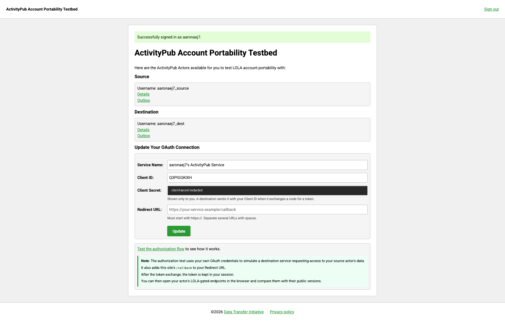
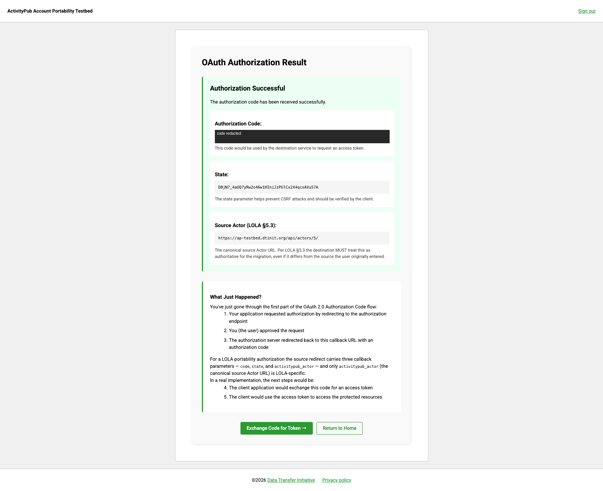
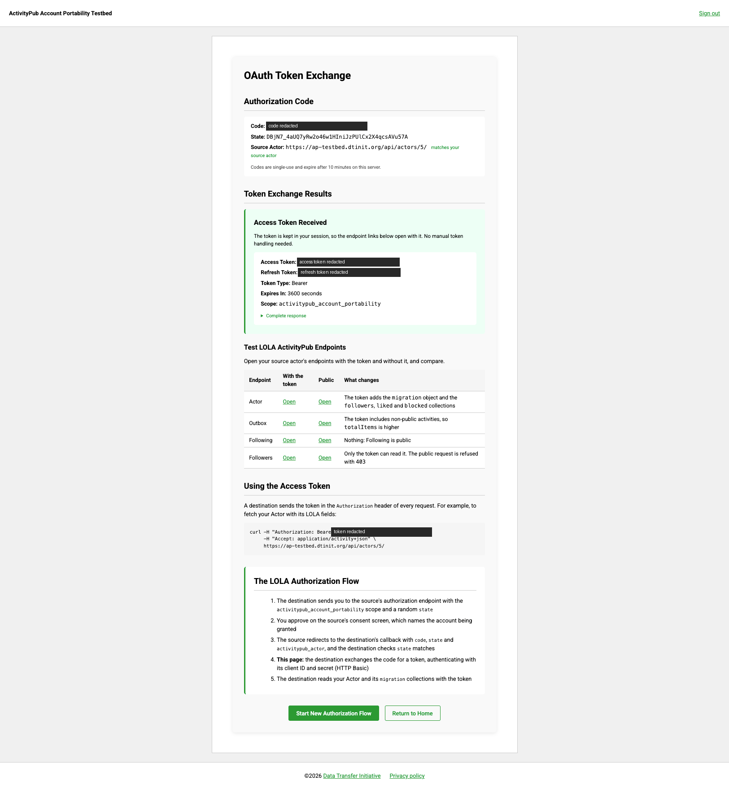
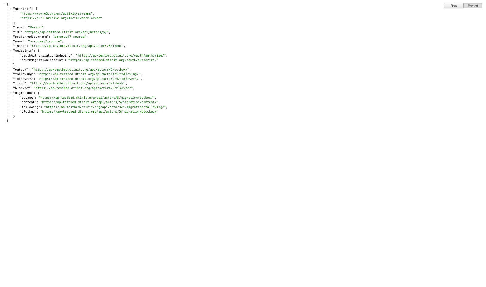
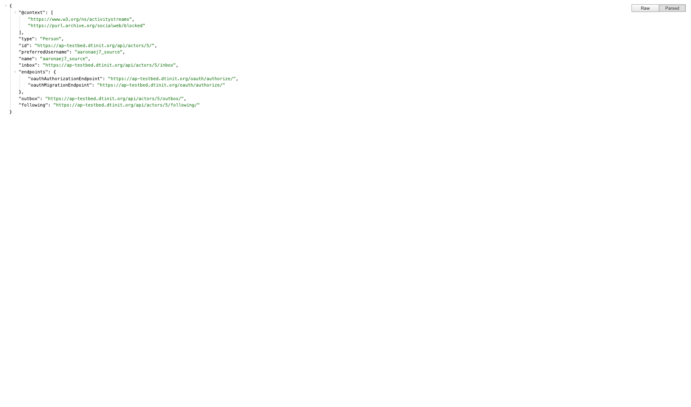
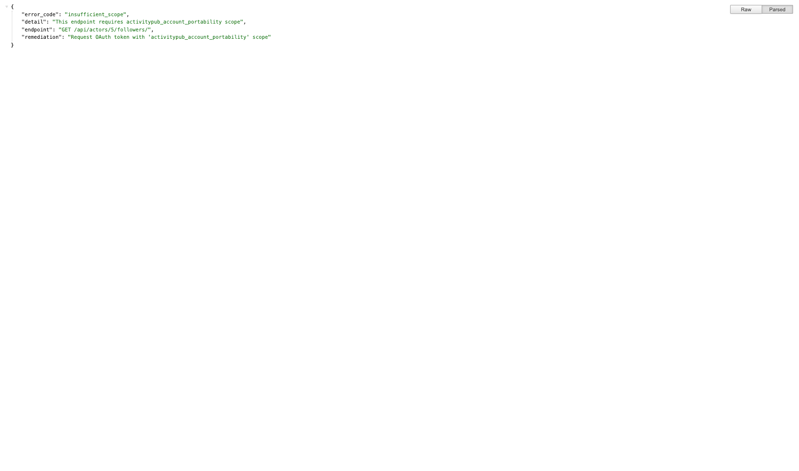
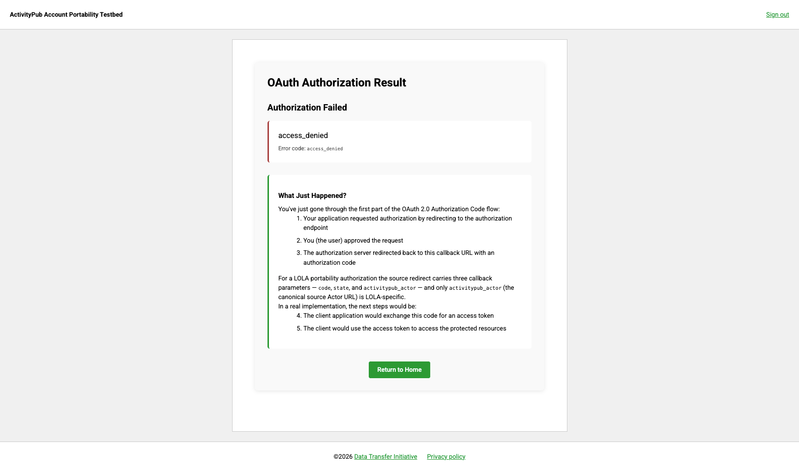

# The Built-in Demo (Mode A)

The testbed has a built-in demo of the LOLA authorization: from the dashboard, one click takes you through the
consent screen, the callback and the token exchange, and then lets you open your own account's endpoints
**with** the portability token and **without** it, side by side. It is the quickest way to see what the token
changes.

The demo plays the destination itself, with shortcuts a real destination does not have (see
[how it differs](#how-the-demo-differs-from-a-real-destination)). To test your own destination, use the
[Source Server Guide (Mode A)](testing/source-server-guide-mode-a.md). The screenshots below are from
`https://ap-testbed.dtinit.org`, with the client secret, the code and the tokens blacked
out.

## 1 · The dashboard

After signing up, the dashboard shows your two actors and **Update Your OAuth Connection**: your client's
Client ID, its Client Secret and its Redirect URLs. At the bottom, **Test the authorization flow** starts the
demo.

Starting the demo adds this site's own `/callback` to your Redirect URL, keeps a random `state` in your
session, and sends you to the authorization endpoint with the portability scope.

## 2 · The consent screen

The screen names the account being granted: its username, its Actor ID and the scope.
**Authorize Data Transfer** approves; **Cancel** refuses (step 6).

## 3 · The callback

After approval, the source redirects to `/callback` with the three LOLA parameters: the `code`, the `state`
the demo sent, and `activitypub_actor`, the account that was granted (LOLA §5.3). The page checks `state`
against your session before showing them.

## 4 · The token exchange

**Exchange Code for Token** sends the code to the token endpoint from the server, authenticating with your
Client ID and Client Secret, and shows the result: an access token valid for an hour, a refresh token, the
type `Bearer` and the scope. Beside the Source Actor, **matches your source actor** confirms that
`activitypub_actor` is your account's Actor ID, built by the same code as the consent screen's.

Do not reload this page: a code is single-use, so a reload spends it again and the exchange fails. Start a
new flow instead.

## 5 · Public versus LOLA-gated

The token is now kept in your session, so the **Test LOLA ActivityPub Endpoints** table can open your
endpoints with it. Each row has two links: **With the token**, and **Public**, which adds `?public_only=true`
so the server ignores the session token and answers as it would an anonymous caller.

| Endpoint | With the token | Public |
|---|---|---|
| Actor | Adds `followers`, `liked`, `blocked` and the `migration` object | Identity, `endpoints`, `outbox` and `following` only |
| Outbox | All 43 activities | The 19 public ones |
| Following | 6 accounts | The same 6: following is public |
| Followers | 8 accounts | Refused: `403 insufficient_scope` |

The Actor, **with the token**: the `migration` object and the three scoped collections appear.

The same Actor, **public**:

Followers, **public**: the scope gate refuses, and the error says which scope is missing.

For every collection and what it holds, see [What Each Collection Holds](collections.md).

## 6 · Cancel

Choosing **Cancel** on the consent screen sends the destination a standard OAuth refusal instead of a code:
`/callback?error=access_denied&state=…`.

The explanation box below the error still describes a successful approval; it is shown on both outcomes.

## How the demo differs from a real destination

The demo runs inside the source, so it can skip what a destination cannot:

| The demo | A real destination |
|---|---|
| Uses the authorize and token URLs it already knows | Discovers them: the Actor's `endpoints.oauthMigrationEndpoint`, then the RFC 8414 metadata |
| Exchanges the code with the client secret it holds on the server | Uses the secret copied from the dashboard |
| Uses this site's `/callback`, which it registers itself | Registers its own callback |
| Opens the endpoints with a session cookie | Sends `Authorization: Bearer` on every request |
| Sends no PKCE | Should send a PKCE challenge (RFC 7636) |

The session token is a convenience for this demo only: it lives in your browser's session cookie, never in a
URL, and expires with the token. To exercise the path a destination actually takes, run the
[Postman collection](testing/source-server-guide-mode-a.md#using-the-postman-collection) or point your own
destination at your account.
