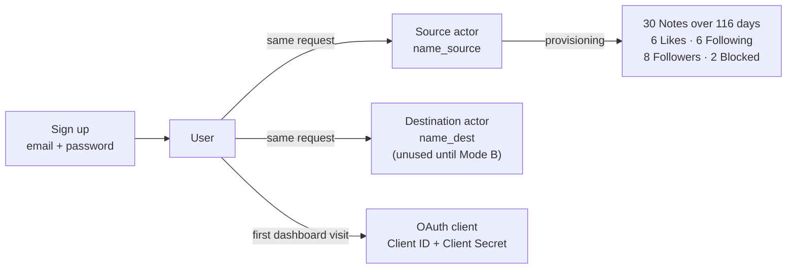
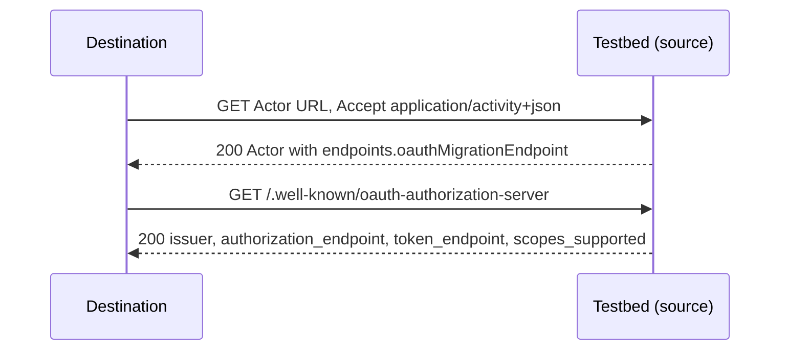
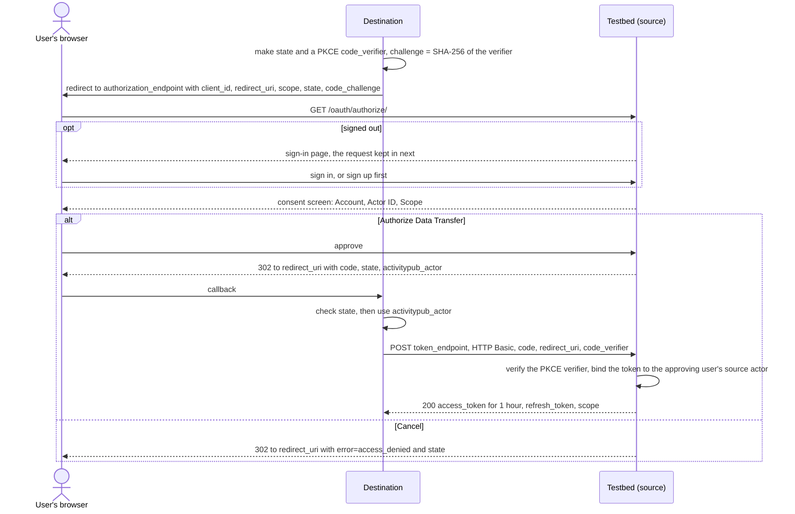
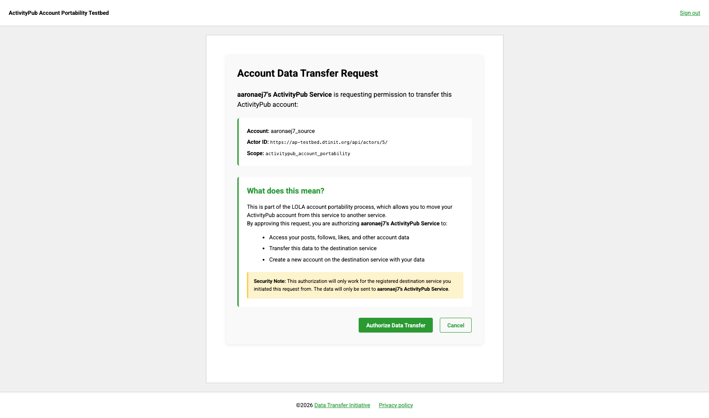
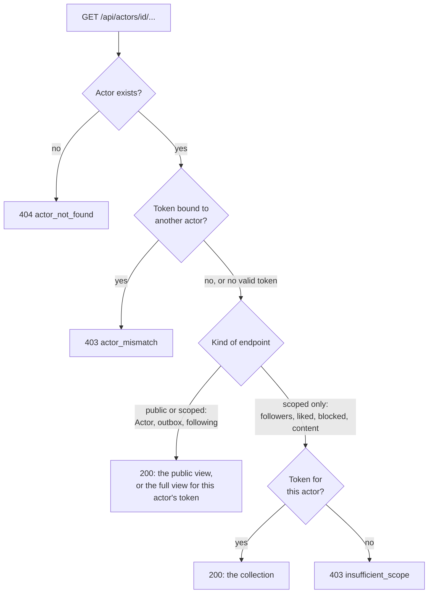
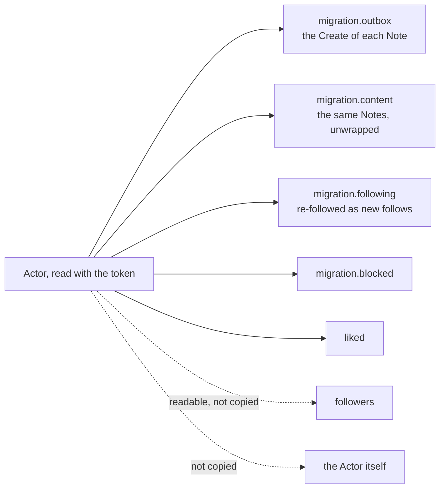

# The Source Server (Mode A)

The ActivityPub Account Portability Testbed implements [LOLA v0.3](https://swicg.github.io/activitypub-data-portability/lola.html),
the account portability specification for [ActivityPub](https://www.w3.org/TR/activitypub/), as a **source**
server: the server an account moves *from*. A destination developer signs up, gets an account full of
content, and points their destination at it. This page explains what the source provides and how each part
works. To test against it, see the [Source Server Guide (Mode A)](testing/source-server-guide-mode-a.md); to
see it in a browser, see the [demo](demo.md).

The testbed will also be a destination (Mode B) and its own counterpart (Mode C). Neither exists yet.

## What a signup gets

Signing up takes an email and a password. In the same request the testbed creates two actors and fills the
source one with content, so a new account has something to migrate at once.



| What | Detail |
|---|---|
| **Notes** | 30, one every 4 days back from the signup, cycling public, followers-only and private (10 of each). Each has a `Create` activity in the outbox |
| **Likes** | 6, of remote Notes, with the same visibility cycle |
| **Following** | 6 remote accounts, each also a `Follow` activity in the outbox |
| **Followers** | 8 remote accounts |
| **Blocked** | 2 remote accounts ([FEP-c648](https://codeberg.org/fediverse/fep/src/branch/main/fep/c648/fep-c648.md)) |
| **Remote accounts** | All on reserved `.example` domains, so a destination that acts on them (for example, re-following) reaches no real server |
| **The OAuth client** | One per account, created on the first dashboard visit. The dashboard shows the Client ID and the plaintext Client Secret, and the account owner registers redirect URLs there |

Every account gets exactly the same content, so the counts are fixed: the outbox holds 19 public activities,
and 43 in all. Provisioned Notes carry no reply, audience or source metadata; that arrives with imported
content.

## Discovery

A destination starts with only the Actor URL the user gives it. LOLA §5 makes the source advertise its
portability authorization endpoint on the Actor, in the [ActivityPub `endpoints`](https://www.w3.org/TR/activitypub/#actor-objects)
property (MUST), and in its [RFC 8414](https://www.rfc-editor.org/rfc/rfc8414) metadata (SHOULD).



On `https://ap-testbed.dtinit.org` the metadata is:

```json
{
  "issuer": "https://ap-testbed.dtinit.org",
  "authorization_endpoint": "https://ap-testbed.dtinit.org/oauth/authorize/",
  "token_endpoint": "https://ap-testbed.dtinit.org/oauth/token/",
  "scopes_supported": ["activitypub_account_portability"],
  "response_types_supported": ["code"],
  "grant_types_supported": ["authorization_code"],
  "activitypub_account_portability": "https://ap-testbed.dtinit.org/oauth/authorize/"
}
```

## Authorization

LOLA uses the [OAuth 2.0 authorization code grant](https://www.rfc-editor.org/rfc/rfc6749#section-4.1) with
one scope, `activitypub_account_portability`, and adds one parameter to the response: `activitypub_actor`,
the account the user actually granted (LOLA §5.3).





What each part does:

- **Sign-in in the middle of a request.** A signed-out user is sent to sign in, with a note saying they will
  return to the request. Signing up from that page keeps the request too, so a new user lands on the same
  consent screen
- **The consent screen names the account** being granted: its username, its Actor ID and the scope. The Actor
  ID comes from the same builder as the `activitypub_actor` the redirect carries, so the two cannot differ
- **`state`** is the destination's protection against forged callbacks: the source returns it unchanged, and
  the destination must check it
- **PKCE** ([RFC 7636](https://www.rfc-editor.org/rfc/rfc7636)) ties the token exchange to whoever started
  the authorization. The destination sends only a hash of its secret `code_verifier` at first, and the
  verifier itself when exchanging the code, so someone who intercepts the code cannot use it. It is optional
  here (destinations authenticate with a client secret anyway), but current OAuth guidance recommends it for
  every client. When a challenge was sent, django-oauth-toolkit verifies the verifier at the token exchange;
  the testing round exchanged codes with a correct verifier, and has not yet tested a wrong one
- **`activitypub_actor`** is authoritative. A user may give the destination one account and then sign in as
  another; LOLA: the destination *"MUST use the Actor ID provided with the authorization code rather than the
  original one the user communicated"*
- **The code** is single-use and expires after 10 minutes. It is exchanged with the client ID and secret as
  [HTTP Basic](https://www.rfc-editor.org/rfc/rfc6749#section-2.3.1)
- **Errors that must not redirect.** An unknown client or an unregistered `redirect_uri` gets the testbed's
  error page, which never repeats the rejected URL, instead of a redirect to it
- **Callbacks must use `https://`** on the deployed testbed, so a code never travels over plaintext (LOLA
  §6.1). The dashboard refuses an `http://` Redirect URL, and so does the authorization endpoint

## What a token can read

The scope is limited to one account. LOLA §5: *"the source server MUST NOT allow access to any other accounts
than the one granted, by requestors using the account migration authorization token."* The testbed binds
each token, when it is issued, to the source actor of the user who approved, and checks that binding on every
request to an actor's data. The binding follows the user who approved, not the owner of the client: one
destination's client can be authorized by many users, each token reading only its own account.



An invalid or expired token is treated as no token: scoped-only endpoints answer `403 insufficient_scope`,
and public-or-scoped ones answer with their public view.

### The public and the scoped surface

As served by production for one account:

| Route | Anonymous | Token bound to this actor | Token bound to another actor |
|---|---|---|---|
| Actor | `200`: identity, `endpoints`, `outbox`, `following` | `200`, adding `followers`, `liked`, `blocked` and `migration` | `403 actor_mismatch` |
| `outbox` | `200`, 19 public activities | `200`, all 43 | `403 actor_mismatch` |
| `following` | `200`, 6 | `200`, 6 | `403 actor_mismatch` |
| `followers`, `liked`, `blocked`, `content` | `403 insufficient_scope` | `200` | `403 actor_mismatch` |
| `migration/outbox` | `200`, the 10 public Notes' `Create`s | `200`, all 30 | `403 actor_mismatch` |
| `migration/following` | `200`, 6 | `200`, 6 | `403 actor_mismatch` |
| `migration/content`, `migration/blocked` | `403 insufficient_scope` | `200`, 30 and 2 | `403 actor_mismatch` |
| A public Note | `200` | `200` | `403 actor_mismatch` |
| A followers-only or private Note | `404 object_not_found` | `200` | `404 object_not_found` |

A hidden object answers exactly like a missing one, so its existence is not revealed.

## What a destination copies

With the token, the Actor carries a `migration` object with exactly four collections, plus the regular
`liked` and `followers`:



- **`migration.outbox` serves only `Create`s** of the account's Notes. Likes reach a destination through
  `liked`, follows through `migration.following`
- **`migration.outbox` and `migration.content` hold the same posts**: one with activity wrappers, one without
- **Followers and the Actor are not copied** (LOLA §6.6): followers belong to other servers' accounts, and
  the destination creates its own Actor. A copied Following becomes new follows, with no historical dates
  (LOLA §3.3.1)
- **Embedded actors are references.** An actor inside a collection carries its identity (`type`, `id`,
  `preferredUsername`, `name`, `inbox`), never another account's collection URLs. Since the token is bound
  to one account, a destination should not dereference an embedded actor's `id` with it

## On the wire

- **Content type** `application/activity+json` ([ActivityPub §3.2](https://www.w3.org/TR/activitypub/#retrieving-objects)).
  `Accept: application/ld+json; profile="https://www.w3.org/ns/activitystreams"` also works; plain
  `application/ld+json` and `text/html` answer `406`
- **One envelope.** Every collection is an [`OrderedCollection`](https://www.w3.org/TR/activitystreams-vocabulary/#dfn-orderedcollection)
  with `id`, `totalItems` and `orderedItems` (never `items`), newest first, in one page. A collection's `id` is
  the URL it was fetched from
- **Every ID ends in `/`** and matches its route; without the slash a URL answers `301`. Notes and activities
  live under their Actor (`/api/actors/<id>/notes/<note>/`), but other servers must read ownership from
  `attributedTo` or `actor`, not the URL
- **CORS.** API responses and LOLA errors carry `Access-Control-Allow-Origin: *`. The framework's own errors,
  such as the `406`, do not

### Errors

LOLA errors are JSON with `error_code`, `detail` and `endpoint`; the two `403`s add `remediation`:

| Status | `error_code` / `error` | When |
|---|---|---|
| `403` | `insufficient_scope` | No valid token on a scoped-only endpoint |
| `403` | `actor_mismatch` | A token used on another account's data |
| `404` | `actor_not_found` | No such actor |
| `404` | `object_not_found` | A missing object, or a hidden one that is not yours |
| `406` | | An `Accept` header the API cannot serve |
| `400` | `invalid_grant` | Token endpoint: a spent, expired or unknown code |
| `401` | `invalid_client` | Token endpoint: a wrong client ID or secret |

## Where it lives in the code

| Part | Code |
|---|---|
| Actors created at signup | `testbed/core/signals.py`, `Actor.objects.create_actors_for_user` in `testbed/core/models.py` |
| Provisioned content | `testbed/core/utils/provisioning.py` |
| The OAuth client per account | `get_user_application` in `testbed/core/oauth/utils.py` |
| The portability scope | `testbed/core/oauth/scopes.py` |
| Consent screen and the `activitypub_actor` redirect | `PortabilityAuthorizationView` in `testbed/core/oauth/views.py` |
| Token binding at issuance | `ActivityPubOAuth2Validator._save_bearer_token` in `testbed/core/oauth/validators.py` |
| Binding and scope checks per request | `testbed/core/views/decorators.py` |
| The API views and the RFC 8414 metadata | `testbed/core/views/api.py` |
| The JSON-LD on the wire | `testbed/core/json_ld_builders.py` |

## References

- [LOLA Portability for ActivityPub, v0.3](https://swicg.github.io/activitypub-data-portability/lola.html):
  §3.3.1 following, §5 discovery and authorization, §5.3 the source's response, §6 the migration collections,
  §6.1 credentials over https, §6.6 what is not copied
- [ActivityPub](https://www.w3.org/TR/activitypub/) (W3C Recommendation): Actor objects and `endpoints`,
  collections, retrieving objects
- [Activity Streams 2.0 Core](https://www.w3.org/TR/activitystreams-core/) and
  [Activity Streams 2.0 Vocabulary](https://www.w3.org/TR/activitystreams-vocabulary/): `OrderedCollection`,
  `Create`, `Note`, `Person`
- [RFC 6749](https://www.rfc-editor.org/rfc/rfc6749): OAuth 2.0, the authorization code grant
- [RFC 6750](https://www.rfc-editor.org/rfc/rfc6750): Bearer token usage
- [RFC 7636](https://www.rfc-editor.org/rfc/rfc7636): PKCE
- [RFC 8414](https://www.rfc-editor.org/rfc/rfc8414): OAuth 2.0 authorization server metadata
- [FEP-c648](https://codeberg.org/fediverse/fep/src/branch/main/fep/c648/fep-c648.md): the Blocked collection
